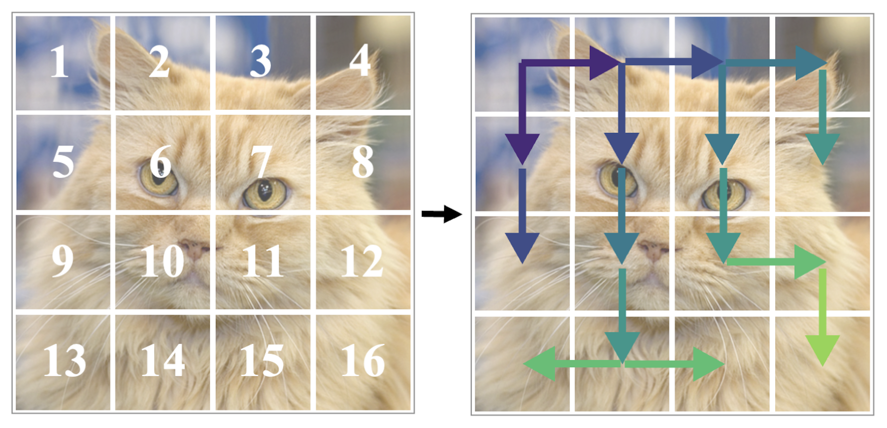

# ⭐ Spanning Tree Autoregressive Visual Generation

> [**Spanning Tree Autoregressive Visual Generation**](https://arxiv.org/abs/2511.17089)  
Sangkyu Lee<sup>1,2*</sup>,
Changho Lee<sup>3</sup>,
Janghoon Han<sup>3</sup>,
Hosung Song<sup>3</sup>,
Tackgeun You<sup>2</sup>,
Hwasup Lim<sup>2</sup>,
Stanley Jungkyu Choi<sup>3</sup>,
Honglak Lee<sup>3,4</sup>,
Youngjae Yu<sup>5</sup><br>
<sup>1</sup>Yonsei University,
<sup>2</sup>KIST,
<sup>3</sup>LG AI Research,
<sup>4</sup>University of Michigan, Ann Arbor,
<sup>5</sup>Seoul National University<br>
<sup>*</sup>Work mainly done during an internship at LG AI Research.

<p align="center">
  
</p>

This is the official implementation of **Spanning Tree Autoregressive Visual Generation (STAR)** supporting:

- ImageNet-1k pretokenization and STAR training scripts
- Pretrained `STAR-B`, `STAR-L`, `STAR-XL`, and `STAR-XXL` checkpoints
- Class-conditional image generation and inpainting interfaces

## Installation

Use Python 3.10 or newer and run commands from the repository root:

```bash
pip install -r requirements.txt
```

## Models

| Model | Configuration | Checkpoint |
|:--- | :--- | :--- |
| `STAR-B` | `configs/star_b.yaml` | [oddqueue/STAR-B](https://huggingface.co/oddqueue/STAR-B) |
| `STAR-L` | `configs/star_l.yaml` | [oddqueue/STAR-L](https://huggingface.co/oddqueue/STAR-L) |
| `STAR-XL` | `configs/star_xl.yaml` | [oddqueue/STAR-XL](https://huggingface.co/oddqueue/STAR-XL) |
| `STAR-XXL` | `configs/star_xxl.yaml` | [oddqueue/STAR-XXL](https://huggingface.co/oddqueue/STAR-XXL) |

Sampling automatically downloads the `pytorch_model.bin` selected by the model configuration and the [MaskGIT-VQGAN](https://huggingface.co/fun-research/TiTok/blob/ab646ed225080a3acb7c78440a574d7f67f16fa7/maskgit-vqgan-imagenet-f16-256.bin) tokenizer checkpoint when they are not available locally by default. Training likewise downloads the tokenizer checkpoint and the [pretokenized JSONL data](https://huggingface.co/yucornetto/RAR/blob/0aed4bfc11a134679915e9c740283cba34e43182/maskgitvq.jsonl) constructed from the ImageNet-1k training set.

To use local files instead, override the corresponding configuration values:

```text
experiment.generator_checkpoint=/path/to/pytorch_model.bin
model.vq_model.tokenizer_checkpoint=/path/to/maskgit.bin
```

## Pretokenization

`scripts/pretokenization.py` reads ImageNet-1k images from `<data-path>/val` and writes `<output-dir>/pretokenized.jsonl`. Each JSONL record contains a `class_id` and the full flattened token grid.

Choose exactly one crop mode:

- `--ten-crop` applies the training-time ten-crop transform.
- `--single-crop` applies the ADM-style center crop used for inpainting
  evaluation.

For example:

```bash
python scripts/pretokenization.py \
  --data-path /path/to/imagenet \
  --output-dir /path/to/tokenized_validation \
  --image-size 256 \
  --single-crop
```

## Training

Training consumes pretokenized JSONL data:

```bash
torchrun --standalone --nnodes=1 --nproc-per-node=16 scripts/train_star.py \
  config=configs/star_b.yaml \
  dataset.params.pretokenized_jsonl=/path/to/pretokenized.jsonl \
  model.vq_model.tokenizer_checkpoint=/path/to/maskgit.bin \
  experiment.output_dir=/path/to/training_run \
  experiment.resume=False
```

With `experiment.resume=False`, training starts from scratch unless `experiment.generator_init_checkpoint` is supplied. `experiment.generator_checkpoint` is used only for sampling. Single-node DDP is supported, but multi-node training is not supported. Set `training.enable_wandb=False` to disable logging through Weights & Biases.

With `experiment.resume=True`, training restores the highest-numbered complete checkpoint in `experiment.output_dir`. A checkpoint is eligible only after its final `COMPLETE` marker is written.

## Sampling

A Python sampling interface is available, as shown below for example. Here, `original_token_ids` contains the original image's flattened tokens, and `masks` contains zero-based, row-major token positions to regenerate:

```python
from omegaconf import OmegaConf
from star.sampling import STARSampler

config = OmegaConf.load("configs/star_b.yaml")
with STARSampler.from_pretrained(config, order_seed=42) as sampler:
    generation = sampler.generate([980], sample_ids=[0])

    completion = sampler.complete(
        class_ids=[980],
        token_ids=original_token_ids,
        masks=[[84, 85, 86, 87]],
        sample_ids=[0],
    )
```

## Evaluation

See [evaluations/README.md](evaluations/README.md) for command-line sampling, evaluation, and reproducing main results.

## Citation

```bibtex
@article{lee2025spanning,
  title={Spanning Tree Autoregressive Visual Generation},
  author={Lee, Sangkyu and Lee, Changho and Han, Janghoon and Song, Hosung and You, Tackgeun and Lim, Hwasup and Choi, Stanley Jungkyu and Lee, Honglak and Yu, Youngjae},
  journal={arXiv preprint arXiv:2511.17089},
  year={2025}
}
```
